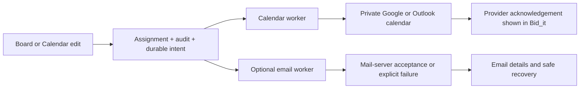

# Work planning, calendar push and optional email — 21 October 2026

This candidate is stacked on OCR/navigation PR #75 (`0bbeb26`), itself based on
main `90891d8d`. It changes planning rather than installing Kan or replacing
the existing stack. Implementation, local qualification, hosted CI and live
provider acceptance are separate.

## Resulting workflow

Board and Calendar show the same project assignments, selected week and filters.
Cards show project, person, time, instructions, status and email evidence.
Planners can create, edit, reschedule, reassign and make legal status changes;
assigned people can confirm or finish their own work. The four columns are the
existing server states: Planned, Confirmed, Done and Cancelled. Keyboard actions
are available without dragging. Local dates, all-day spans and ICS DATE values
preserve daylight-saving boundaries.

Saving commits assignment, revision, audit and delivery intent together.
External work happens on the durable database queue. A changed assignment
immediately queues its connected owners' calendar updates; reassignment also
queues removal of the old owner's managed event. There is no guarantee that a
phone renders an acknowledged event immediately.

Calendar exports use a separate private calendar, never attendee invitations.
Bid_it is the scheduling authority; external edits are not imported.
OAuth uses single-use browser/session/tenant-bound state, PKCE, sealed refresh
credentials and a connection generation fence. Revoked membership, disabled
accounts and suspended workspaces stop future export and wipe credentials.
Reactivation requires deliberate reconnection. Disconnect stops future writes;
already exported events remain under the external account's control.

Event identities persist before external I/O. Uncertain provider creates are
looked up by their stable identity rather than blindly re-created. Initial and
explicit retry reconciliation pages through 100 assignments at a time within
a -30/+365 day initial horizon, plus existing mappings for cleanup. Subsequent
assignment edits queue their own update regardless of that initial horizon.
Failed/unknown/configuration/reauthorization states remain visible.

Each assignment has separate assignee-change email, upcoming reminder and
customer-arrival controls. Existing organization customer-notice defaults can be
inherited or overridden. Unconfigured SMTP is blocked, not sent. A worker commits
its sending claim before SMTP; uncertain outcomes cannot be blindly resent.
“Accepted by mail server” describes that evidence, not recipient reading.
Workers recheck current authority and recipient linkage before delivery.

## Activation on Hostinger

No real account was connected and no email, invitation or deployment was sent.
The candidate must pass hosted qualification and be reviewed/merged before
deployment. Existing credentials must never be posted in chat or committed.

1. Register a Google OAuth web application and enable Calendar API. Register an
   appropriate Microsoft Entra web application for the tenant/account types you
   intend to support. Set exact HTTPS redirect URLs:
   `https://YOUR-APP/api/v1/schedule/calendar-connections/google/callback` and
   `https://YOUR-APP/api/v1/schedule/calendar-connections/outlook/callback`.
   Include any configured public API path prefix.
2. Set optional server environment variables using
   [the Hostinger template](../../.env.hostinger.example):
   `GOOGLE_CALENDAR_CLIENT_ID`, `GOOGLE_CALENDAR_CLIENT_SECRET`,
   `OUTLOOK_CALENDAR_CLIENT_ID`, `OUTLOOK_CALENDAR_CLIENT_SECRET`.
   `CALENDAR_PUBLIC_APP_URL` and `API_PUBLIC_BASE_URL` must resolve to the
   intended public HTTPS origins; keep app/API same-origin or same-site for
   browser-bound OAuth cookies (unrelated domains may be blocked); the Compose template derives them from
   `APP_ORIGIN`. Configure `SMTP_HOST`, `SMTP_PORT`, `SMTP_USER`,
   `SMTP_PASSWORD`, `SMTP_STARTTLS` and `SMTP_FROM` for optional email.
3. The standard worker can consume these persisted jobs. To avoid waiting behind
   OCR, opt into the existing-image lightweight lane using
   `COMPOSE_PROFILES=calendar` for deployment. It consumes `calendar.sync`,
   `schedule.email`, `assignment.reminder` and `assignment.client_notice`.
   Database claims arbitrate overlapping consumers; this is no timing SLA.
4. Each user opens Work planning → Calendar connections and grants consent for
   their own account. Unconfigured controls explain the missing setup. Setup
   uncertainty uses Check & retry sync; expired consent requires reconnecting.
5. Verify create, reschedule, reassignment and cancellation against both actual
   provider calendars; check provider acknowledgements and optional email
   evidence. Capture actual timestamps, duplicate counts, access removal and
   worker latency before claiming live completion.

Google scopes: Calendar app-created calendars and calendar-list read-only
(required to recover uncertain setup and bind the account).
Conditional Google event changes use documented If-Match preconditions. Graph
requests also require event ETags and send If-Match; Microsoft event documentation
does not explicitly guarantee that precondition. The live sandbox pilot must
prove stale update/delete refusal before claiming protection against concurrent
external attendee edits. Do not turn managed events into meetings.
Microsoft scopes: delegated Calendars.ReadWrite and offline_access. Each
provider's application verification, consent and tenant policy still apply.

## Reference and design choices

Kan was inspected at
[`006c1e7be1756afb357b7eccf02b6818b8d67b3a`](https://github.com/kanbn/kan/tree/006c1e7be1756afb357b7eccf02b6818b8d67b3a).
Useful patterns are compact cards, shared Board/Calendar records and keyboard
controls. Its calendar is due-date based and does not supply the requested
appointment/Google/Outlook workflow. Its source is AGPLv3; no Kan code was copied
and no second application/framework was installed. The implementation uses the
existing React, FastAPI, SQLAlchemy, HTTP client, mail and job infrastructure.

Primary provider references:
[Google OAuth](https://developers.google.com/identity/protocols/oauth2/web-server),
[Google event insert](https://developers.google.com/workspace/calendar/api/v3/reference/events/insert),
[Google scopes](https://developers.google.com/workspace/calendar/api/auth),
[Microsoft authorization code flow](https://learn.microsoft.com/en-us/entra/identity-platform/v2-oauth2-auth-code-flow),
[Graph event creation](https://learn.microsoft.com/en-us/graph/api/calendar-post-events),
[Graph calendar creation](https://learn.microsoft.com/en-us/graph/api/user-post-calendars).
Detailed pinned research and receipts are retained in the task artifact directory.

## Action descriptions and maintenance prompts

| Control | Contract / engineering prompt |
| --- | --- |
| Board / Calendar | Switch presentation over the same scoped assignment query. Preserve selected week, filters and keyboard access; never create a second task population. |
| Previous / This week / Next and filters | GET the local date window. Preserve DST boundaries and distinguish unavailable data from an empty week; do not enqueue work. |
| New assignment / Save | Validate person, project and window, persist preferences and read back the committed assignment. Preserve uncertain drafts for GET review; implement PLAN-CREATE before command replay. |
| Edit / Save changes | Send the observed revision, preserve unchanged sub-minute timestamps and show stale409 recovery. Prove one committed revision and corresponding delivery intent. |
| Confirm / Mark done / Return to planned / Cancel | Enforce canonical transitions and planner/own-assignee permissions. Confirm cancellation and queue provider removal; preserve response/readback uncertainty. |
| Refresh plan / Reload latest values | GET only; preserve draft on failure. Never repeat a mutation to discover its outcome. |
| Calendar connections / Hide | Lazily inspect current-account evidence. Reset private state on identity change and suppress late callbacks after navigation. |
| Connect Google / Outlook | Explain disabled configuration, persist one browser-bound consent attempt and navigate only to the selected provider HTTPS host. Recover interrupted/denied consent through current server status. |
| Check & retry sync | Commit a bounded coalesced reconcile/setup job, then GET status. Lock writes after uncertain responses; never blindly recreate an ambiguous external event. |
| Disconnect | Wipe credentials and advance the generation fence. Recheck after external I/O boundaries; explain that already exported events remain. |
| Refresh calendar status | GET provider acknowledgements and pending/failure evidence without writes or device-refresh claims. |
| Email details / Check email status | GET current delivery evidence and distinguish change/reminder/customer notices. Failed reads cannot become empty or sent states. |
| Retry email | Require current authority, configured SMTP and a blocked/definite failed intent. Serialize attempts; unknown/sending outcomes require inspection. |
| Subscription / Copy link / Replace link | Explain provider polling and link sensitivity. Report clipboard errors; confirm replacement, invalidate old tokens and preserve truthful failure recovery. |

## Remaining development contracts

| ID / control | Required behavior and engineering prompt |
| --- | --- |
| PLAN-ACCEPT / connected pilot | Connect synthetic Google and Microsoft accounts after owner configuration. Exercise actual UI → API → PostgreSQL → worker → provider create/edit/reassign/cancel; verify one event per source, provider acknowledgement, opt-outs, account removal and delayed/denied/uncertain recovery. Record latency/resources without promising phone refresh. |
| PLAN-CREATE / Save assignment | Add tenant/user-bound durable create command identity, payload binding and authorized outcome lookup. Prove lost-response recovery produces one assignment/audit/notice/calendar intent under PostgreSQL concurrency. Current UI preserves the uncertain draft, disables Save and offers GET review; it does not claim replay-safe creation. |
| PLAN-LIFECYCLE / unscheduled work orders | Introduce a reviewed work-order entity only if work must exist without a person/time. Define backlog, actual in-progress, acceptance and project links before adding those columns. Migrate existing assignments without guessing business state; preserve permissions, history and financial links. |
| PLAN-INBOUND / calendar edits | If two-way editing is selected, define provider/source ownership, conflicts, deletion and recurrence before implementation. Persist webhook renewal and reconciliation cursors, scope notifications to the authenticated connection, and prove replay/revocation handling. Current integration is outbound only. |
| PLAN-CAPACITY / prompt processing | Measure queue wait, provider429/backoff, mailbox failures, resource use and interactions with OCR on the actual VPS. Qualify the optional worker before publishing latency/capacity claims. |
| PLAN-RETENTION / disconnect cleanup | Define optional remote-calendar removal/retention with the user before adding destructive controls. Current disconnect deliberately leaves exported events and states that behavior. |

## Qualification

| Local check | Result and scope |
| --- | --- |
| Schedule, delivery, access, ICS and core contracts | 71 passed. |
| Calendar providers / workers / OAuth API | 119 passed: 71 HTTP-adapter, 33 worker and 15 OAuth/API controls. External providers mocked. |
| PostgreSQL | 33 passed, including 7 new calendar and 3 new email/revision concurrency cases; nonsuperuser with enforced RLS. |
| Deployment / image inventory contracts | 121 passed plus six actual synthetic Compose renders. |
| Documentation / schema / migrations / route governance | 63 passed; generated ERD matches 118 tables, 151 revisions and one migration head. |
| Backend static / collection | Ruff, formatting and mypy (428 app modules) pass. 4,803 cases collected; the full backend suite was not executed locally. |
| Frontend static / build / bundle | Pass, using the inherited qualified compiler. First load 435.2 kB raw / 128.5 kB gzip versus unchanged 460/135 limits. |
| Browser | Final full suite: 749 passed, zero retries/skips/flaky outcomes, on the configured origin. Includes planning/date/arrival and final 10 connection controls; synthetic API fixtures. |
| Backend runtime snapshot | 42 schedule tests plus UTC/Riga, 23/25-hour days, ICS and email window smoke pass under Python3.14.8 as an unprivileged read-only network-isolated container. Final-source image gate still required. |
| Hosted qualification | Initial head257eecc passed required lint, PII, PostgreSQL, frontend, browser and final-image jobs; backend failed two contract/policy checks, repaired below. Fresh qualification remains pending for the repair head. The earlier OCR/navigation head passed CI39552505873; it does not qualify these changes. |

The [source and evidence receipt](work-order-planning-2026-10-21-evidence.json)
records final file and artifact hashes. These cohorts overlap and are not summed
into a full-stack or independent end-to-end count. Synthetic browser APIs and
mocked provider HTTP are not live account acceptance. No screenshot baseline,
dependency, permission tuple or security gate is relaxed.

The initial broad browser attempt used an isolated port5178 and returned 745
passes/3 failures: existing redirect/storage-event controls explicitly use5173.
The failing evidence is retained; the final run uses the configured origin with
strict port ownership and passes all 749 cases. No product assertion or timeout
was weakened.

NGINX runtime testing exposed that access-log masking alone still leaked OAuth
queries in fixed-format upstream error logs. The callback locations now suppress
those unredactable error lines while retaining masked access status and backend
diagnostics. Both default and TLS configurations were exercised against an
unavailable upstream with synthetic codes; access and error outputs were checked.

Two additive migrations introduce assignment delivery preferences/revisions and
three tenant integration tables. Scheduling writers and all workers must stop
before migration. Retain the additive schema for application rollback; old
writers ignore the new controls. Delivery-profile downgrade refuses nondefault
preferences or revisions. Calendar-schema removal loses connector metadata and
does not remove external events. Back up first and reconnect/reconcile deliberately.

## Hosted CI follow-up

[CI39558101942](https://github.com/kristapsgoncoronoks-ship-it/SME-financial-workspace/actions/runs/39558101942)
finished with 4,629 backend passes, 170 skips and two failures. Both were
reproduced locally before the repair: the generated OpenAPI snapshot omitted
seven new paths and five additive schemas, and the provider response-size gate
was outside the central processing-budget policy.

The OpenAPI snapshot is regenerated from the unchanged API implementation.
Independent review found no removed paths/properties or incompatible request
changes; the frontend's local interfaces match the actual serializers. Generic
response schemas for calendar/notification list/retry routes and the callback's
advertised 200 instead of runtime303 remain documentation follow-ups; this CI
repair does not change those routes.

The fixed calendar response ceiling remains 256KiB, now owned by
`filesec.RESOURCE_BYTES`. The structural scanner accepts only direct,
known-literal-key lookups into that owner in addition to the existing upload
limit calls. Seven seeded alternatives still fail; there is no new skiplist.
The adapter's new runtime test lowers the central response budget and proves the
stream boundary honors it. The preceding adapter fails that exact control with
`DID NOT RAISE`; normal budget and oversize behavior remain covered.

The final follow-up cohort passed 144 cases across calendar, cap-policy, API
snapshot and documentation tests. Ruff/format and mypy428 pass; 4,803 backend
cases are collected. The original failed run and local red controls are retained
in the task artifact directory. The updated source/evidence receipt distinguishes this follow-up from
the original local cohorts. Fresh hosted qualification is required for the new
commit. No deployment, provider calls, dependency, timeout, visual baseline or
security threshold is changed.
